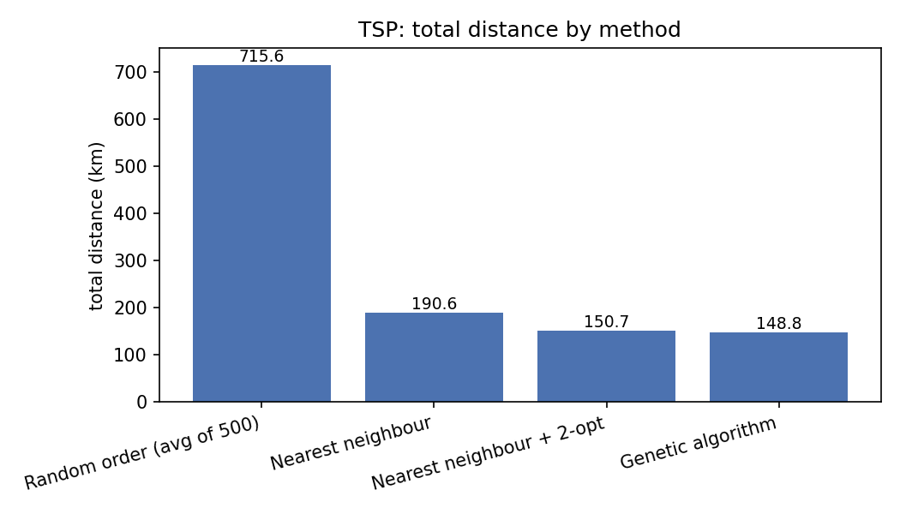
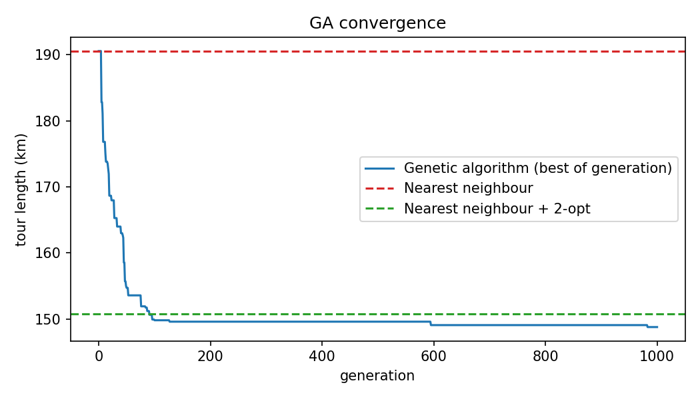
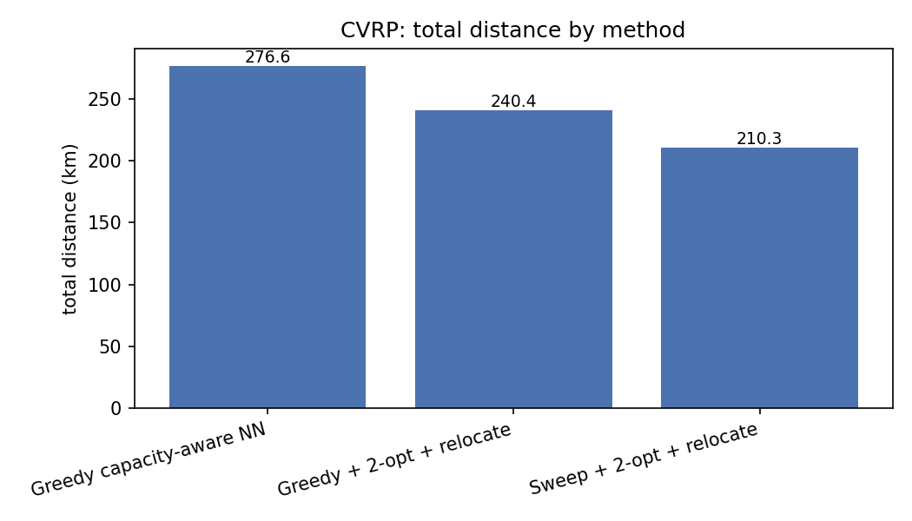
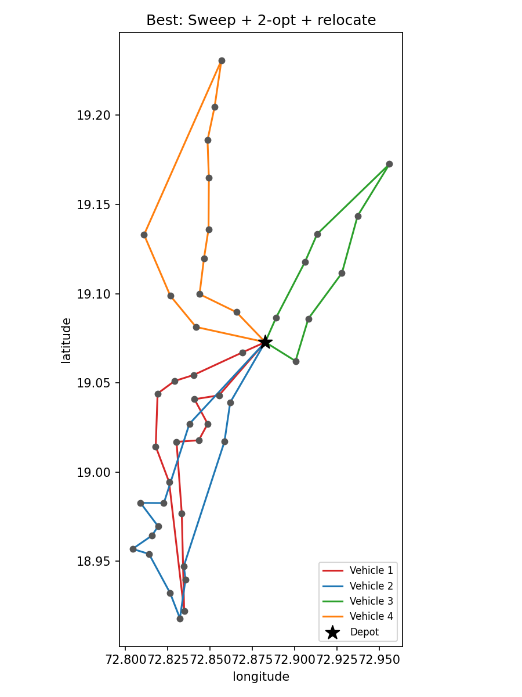

# Mumbai Delivery Route Optimizer: Results Report

This report summarises what the experiments in this project show. All numbers come from
`python run.py` (seed 42, OR-Tools enabled, 10 s OR-Tools time limit per problem, 2000 simulated
days per method). The same run was repeated three times and every distance and simulation figure
came out identical; only the runtimes changed. That confirms the seeded results are reproducible.

**Setup in one paragraph.** One depot in Kurla and 45 stops across Mumbai (Colaba to Borivali,
Mulund and Powai). Distances are straight-line (haversine) x 1.35 as a detour factor, so every
kilometre figure is an estimate. Parcels per stop (1 to 10) are simulated. Total demand is 277 parcels.

---

## 1. Part 1: one vehicle, all 45 stops (TSP)

| Method | Distance (km) | Better than random | Runtime (s) |
|---|---|---|---|
| Random order (avg of 500) | 715.64 | - | 0.00 |
| Nearest neighbour | 190.55 | 73.4% | 0.00 |
| Nearest neighbour + 2-opt | 150.74 | 78.9% | 0.01 |
| Genetic algorithm | 148.76 | 79.2% | 15 to 19 |
| Google OR-Tools | **147.61** | 79.4% | ~10 |

**What the results show**

- **Any sensible method beats random by a huge margin.** Even plain nearest neighbour cuts the
  tour from 715.6 km to 190.6 km (-73%).
- **2-opt is the best value.** It removes another 20.9% (190.55 to 150.74 km) in about 0.01 s.
- **The last few percent are expensive.** The genetic algorithm saves only 1.3% over NN + 2-opt and
  takes roughly 1500x longer. OR-Tools is 2.1% shorter than NN + 2-opt and 0.8% shorter than the GA,
  in about 10 s.
- **The GA converges early.** In `results/ga_convergence.png` the best tour passes the NN + 2-opt level
  at around generation 100 and then flattens. Only two small improvements appear after that
  (near generations 600 and 980), so 1000 generations is more than this instance needs.

**Conclusion for Part 1:** OR-Tools gives the shortest tour (147.61 km), but NN + 2-opt is within
2.1% of it at essentially zero cost. The three better methods are all within about 2% of each other,
which suggests the optimum is close to 147 km for this instance (this is an observation, not a proof).

---

## 2. Part 2: 4 vehicles, capacity 75 parcels each (CVRP)

Fleet capacity is 300 for 277 parcels, so the fleet is about 92% full.

| Method | Distance (km) | Vehicles used | Better than greedy | Runtime (s) |
|---|---|---|---|---|
| Greedy capacity-aware NN | 276.64 | 4 | - | 0.00 |
| Greedy + 2-opt + relocate | 240.40 | 4 | 13.1% | 0.00 |
| Sweep + 2-opt + relocate | 210.33 | 4 | 24.0% | 0.01 |
| Google OR-Tools | **190.80** | 4 | 31.0% | ~10 |

**What the results show**

- **The starting solution matters a lot.** Local search (2-opt + relocate) improves both starts, but
  the sweep start ends 12.5% shorter than the greedy start (210.3 vs 240.4 km). Sorting stops by
  angle around the depot gives compact, non-overlapping routes that greedy filling does not.
- **OR-Tools is 9.3% shorter than the best heuristic** (190.8 vs 210.3 km) and 31.0% shorter than greedy.
  So the simple sweep + local search pipeline closes most of the gap, but not all of it.
- **OR-Tools routes are unbalanced in distance.** Best plan from OR-Tools:

| Vehicle | Stops | Load | Distance (km) |
|---|---|---|---|
| 1 | 11 | 70/75 | 57.7 |
| 2 | 14 | 75/75 | 55.4 |
| 3 | 12 | 74/75 | 37.6 |
| 4 | 8 | 58/75 | 40.1 |

  Vehicles 1 and 2 drive about 55 to 58 km, vehicles 3 and 4 only about 38 to 40 km. The solver
  minimises total distance, not the longest route, so nothing pushes it to balance the vehicles.
  This matters in Part 3, because the day ends when the slowest vehicle gets back.
- **Capacity is nearly binding.** Vehicle 2 is exactly full and vehicle 3 is at 74/75.

**Conclusion for Part 2:** OR-Tools gives the lowest total distance (190.8 km). If a simple,
dependency-free method is needed, sweep + 2-opt + relocate is a reasonable second choice
(+10.2% distance over OR-Tools).

---

## 3. Part 3: Monte Carlo simulation (2000 random days per method)

Assumptions (all of them are assumptions, not measured data): 25 km/h base speed, rush-hour
slowdowns, rain on 15% of days, random service times, 5% failed deliveries, a 5.0 h shift.

| Method | Planned km | Mean route (h) | Mean finish (h) | P95 finish (h) | Overtime prob. | Mean overtime (h) | Expected cost (INR) |
|---|---|---|---|---|---|---|---|
| Greedy capacity-aware NN | 276.6 | 4.94 | 6.15 | 7.77 | 96.6% | 1.91 | 9,797 |
| Greedy + 2-opt + relocate | 240.4 | 4.54 | 5.54 | 6.92 | 78.2% | 0.84 | 9,095 |
| Sweep + 2-opt + relocate | 210.3 | 4.16 | 4.65 | 5.76 | 21.1% | 0.19 | 8,572 |
| Google OR-Tools | 190.8 | 3.97 | 4.65 | 5.88 | 22.1% | 0.19 | **8,336** |

**What the results show**

- **Plan quality turns into real operational risk.** A greedy plan ends the day after the 5 h shift
  in about 97% of simulated days (mean finish 6.15 h, P95 7.77 h). The sweep and OR-Tools plans cut that to
  about 21 to 22%.
- **Shorter planned distance helps less than the planning numbers suggest.** OR-Tools plans 9.3% fewer km
  than Sweep, yet both have the same mean finish time (4.65 h) and nearly the same overtime
  probability (22.1% vs 21.1%). Sweep even has a slightly better P95 finish (5.76 vs 5.88 h). The likely
  reason is the imbalance seen in Part 2: finish time is set by the longest route, and OR-Tools
  optimises total distance, not the longest route. This is an interpretation; it was not tested directly.
- **OR-Tools still has the lowest expected cost** (8,336 INR), 14.9% below greedy and 2.8% below Sweep,
  so it remains the best choice on cost. The margin over Sweep is small.
- **Ranking by distance and by expected cost agree**, so the ordering of the four methods is
  stable: Greedy < Greedy + local search < Sweep ~ OR-Tools.

---

## 4. Fleet size what-if (Sweep + 2-opt + relocate)

Capacity per vehicle is scaled so total fleet capacity is about 110% of demand (for example
3 vehicles x 102, 7 vehicles x 44). The 4-vehicle row therefore uses capacity 77, not 75, but it lands
on the same 210.3 km plan as Part 2.

| Vehicles | Capacity | Planned km | P95 finish (h) | Overtime prob. | Expected cost (INR) |
|---|---|---|---|---|---|
| 3 | 102 | 197.2 | 7.87 | 97.8% | 7,224 |
| 4 | 77 | 210.3 | 5.76 | 21.1% | 8,572 |
| 5 | 61 | 244.0 | 5.91 | 23.4% | 10,473 |
| 6 | 51 | 251.9 | 5.44 | 13.5% | 12,038 |
| 7 | 44 | 279.3 | 4.79 | 2.7% | 13,855 |

**What the results show**

- **3 vehicles is not feasible for a 5 h shift.** Overtime happens on 97.8% of days even though it is the
  cheapest plan on paper.
- **Cost rises with every extra vehicle** (roughly 1,300 to 1,900 INR per vehicle), while planned km also
  grows because each vehicle makes its own trip out of and back to the Kurla depot.
- **Overtime falls with more vehicles, but not smoothly.** 4 to 6 vehicles brings it from 21.1% to 13.5%,
  and 7 vehicles reaches 2.7%. Reaching a low overtime probability costs about 5,300 INR more per day
  than the 4-vehicle plan (13,855 vs 8,572).
- **The 5-vehicle row is worse than the 4-vehicle row** (P95 5.91 vs 5.76 h, overtime 23.4% vs 21.1%),
  which should not happen with a real extra vehicle. The most probable explanation is that the sweep
  heuristic produced an uneven split at that fleet size, leaving one long route. It is an
  artifact of the heuristic rather than a real effect, but this was not checked route by route.

**Conclusion for Part 4:** There is no free option. 4 vehicles is the cheapest plan that is
feasible, but it runs over about one day in five. 7 vehicles nearly removes overtime but raises cost
by about 62%. Which one is right depends on how costly an overtime day is in practice.

---

## 5. Overall conclusions

1. **Start with a good construction heuristic, then local search.** Sweep + 2-opt + relocate gets within about
   10% of OR-Tools on CVRP and within about 2% on TSP (with NN + 2-opt), in hundredths of a second.
2. **OR-Tools gives the best plans in every comparison**, on distance and on expected cost, for a
   10 s time limit.
3. **The genetic algorithm is not worth it here.** It is slower than OR-Tools and barely better than 2-opt.
4. **Minimum distance is not the same as minimum risk.** Once randomness is added, the OR-Tools advantage
   shrinks. A formulation that balances route lengths (or minimises the longest route) is the obvious
   next experiment.
5. **The 5 h shift is the binding constraint,** not vehicle capacity. Fleet size decisions should be based on the
   overtime/cost trade-off in section 4.

## 6. Suggested next steps

- Minimise the longest route (or add a balance penalty) in OR-Tools and re-run the simulation.
- Inspect the 5-vehicle sweep solution to confirm the uneven-split explanation.
- Repeat with real OSRM road distances and with several seeds to get confidence intervals.
- Test larger instances (100+ stops), where OR-Tools and simple heuristics are likely to diverge more.
